## 🚀 À propos de moi

- 🔧 **SRE / Platform Engineer** — cloud souverain français (numspot / Cloud Temple)
- 🦀 Auteur du **[ClamAV Operator](https://github.com/SolucTeam/clamav-operator)** — antivirus Kubernetes-native avec scan incrémental smart (100× plus rapide), air-gap ready
- ☸️ Je construis des **opérateurs Kubernetes** (Kubebuilder / controller-runtime), du **Crossplane**, du **GitOps** (Flux, ArgoCD)
- 🏗️ Infrastructure as Code de A à Z : **Terraform, Ansible, Helm, Kustomize**
- 🔐 Observabilité **Prometheus / Grafana / Loki** et sécurité supply-chain (cosign, SBOM, Trivy)

## 🛠️ Stack technique

**Langages**  

**Cloud Native**  

**IaC & Ops**  

## 🌟 Projets mis en avant

| Projet | Description |
|--------|-------------|
| 🦀 **[clamav-operator](https://github.com/SolucTeam/clamav-operator)** | Opérateur antivirus Kubernetes-native — scan sur chaque nœud, incrémental smart, air-gap ready, supply-chain sécurisée (cosign, SBOM) |
| 🤖 **[agentic-platform](https://github.com/crabearaignee/agentic-platform)** | Architecture plateforme agentique : infrastructure, déploiement et opérations |
| 📏 **[agentic-rules](https://github.com/crabearaignee/agentic-rules)** | Corpus de règles agentiques — SDLC commun aux serveurs MCP et projets dérivés |

## 📊 Stats GitHub

## 🤝 Me retrouver

